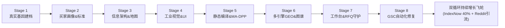

# B2B Export Site Super Orchestrator · 全生命周期 Master 总控 Skill

[](https://github.com/cnproduct/b2b-export-site-super-orchestrator)
[](https://opensource.org/licenses/MIT)
[](references/skill-dependency-matrix.md)

**全生命周期外贸出海独立站 Master 总控调度引擎**：以唯一状态机契约 (`site-lifecycle.json`) 驱动 8 阶段全流程闭环，按需调度本地与 GitHub 上 90+ 个专业出海、建站、SEO/GEO 及验证技能。

---

## 🏛️ 八阶段全生命周期架构



| 阶段 | 阶段名称 | 核心职能 | 核心联动子技能 (90+ Skills) |
|:---:|---|---|---|
| **01** | **企业真实基因与资质真理建档 (DNA & Truth)** | 21 模块事实档案；资质证书编号锁定；事实、观察、假设三层隔离 | `exporter-profile-skill`, `product-truth-builder`, `ingest-enterprise-assets` |
| **02** | **目标买家画像、JTBD 与欧亚标准矩阵 (ICP & Standards)** | 采购委员会 4 角色决策弹药；6 大商业意图分支词树；美标 ASTM vs 德标 DIN vs 俄标 ГОСТ 对照 | `define-buyer-icp`, `product-search-mapping-skill`, `analyze-country-market` |
| **03** | **信息架构规划、动态 Sitemaps 与规范标签契约 (IA & Sitemaps)** | 短路径 Clean URLs 规范；拆分主站 `sitemap.xml` 与合规 `sitemap-dpp.xml`；100% 自引用 Canonical | `B2B Portal Builder with Sitemaps`, `b2b-geo-portal-builder` |
| **04** | **视觉识别系统、反 AI-Slop UI 与设计令牌 (VI & Anti-Slop)** | 四大工业原型配色；OKLCH 染色中性色；禁用霓虹渐变与 `shadow-xl`；字体与排版合规审计 | `brandvision`, `brand-visual-director`, `svg-logo-designer`, `layout-typography-auditor` |
| **05** | **同源静态编译、MA-DPP 欧盟护照与 Clean URLs (SSG & MA-DPP)** | 单一事实源预渲染；MA-DPP 独立静态着陆页（`/dpp-{sku}`）与 ISO 15459 结构化数据；Anti-FOUC 四大防线 | `ma-dpp-certification-master`, `build_dpp_static_pages.py`, 垂直行业 SSG 技能库 |
| **06** | **全球多引擎 GEO、五层 AI 端点与知识图谱互锁 (GEO & Graph)** | 134–167 词直答块（BLUF+IGN）；`/llms.txt` (v2) 与 `/ai/*.json`；Wikidata 永久实体 QID 双向互锁；Yandex Clean-param 与俄语直答 | `b2b-gemini-geo-citation-engine`, `b2b-foss-lubricants-builder` |
| **07** | **零摩擦工作台、海运双模算力与 RFQ 守护 (Workbench & RFQ)** | 免注册首屏规格/BOM/装柜测算器；体积与重货限重（26.5T）双模装柜算力；三级风险逆转询盘卡；HMAC 蜜罐防刷守护 | `design-commercial-offer`, `design_math.py`, `rfq_daemon.py` |
| **08** | **GSC 自动化取证修复与双循环持续收录飞轮 (GSC & Flywheel)** | `ego-browser` 自动化修复 GSC 6 大未收录原因并一键触发 Validation；IndexNow 40% 冷页轮巡保鲜 + Reddit 工程师引流 | `scripts/gsc_ego_operator.js`, `cloudflare-indexnow-traffic-optimizer`, `reddit-b2b-b2c-geo-scheduler` |

---

## ⚡ 快速开始

### 1. 初始化项目生命周期中枢
```bash
python3 scripts/super_orchestrator.py init \
  --domain example.com \
  --industry electronics \
  --out /path/to/project
```

### 2. 检查全生命周期阶段与健康度
```bash
python3 scripts/super_orchestrator.py status --project /path/to/project
```

### 3. 执行特定阶段的确定性闸门审计
```bash
python3 scripts/super_orchestrator.py audit-gate --stage 5 --project /path/to/project
```

### 4. 自动化修复 Google Search Console 6 大未收录原因
```bash
ego-browser nodejs scripts/gsc_ego_operator.js example.com validate-all
```

---

## 📚 核心文档索引

- [全生命周期 Master 调度编排协议规范](references/lifecycle-orchestrator-spec.md)
- [90+ 出海细分技能依赖与调度映射矩阵](references/skill-dependency-matrix.md)
- [GSC 深度取证与全项自动化修复 SOP](references/gsc-forensic-remediation-sop.md)
- [MA-DPP 欧盟合规与静态落地页架构指南](references/ma-dpp-compliance-and-static-architecture.md)
- [Yandex SEO 与中亚 GEO 深度优化全景实操指南](references/cis-yandex-geo-mastery.md)

---

## License
MIT License © 2026 cnproduct
