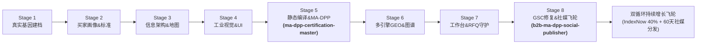

# B2B Export Site Super Orchestrator · 全生命周期 Master 总控 Skill

[](https://github.com/cnproduct/b2b-export-site-super-orchestrator)
[](https://opensource.org/licenses/MIT)
[](references/skill-dependency-matrix.md)
[](references/multi-site-audit-and-optimization-roadmap.md)
[](scripts/orchestrate_ma_dpp.py)

**全生命周期外贸出海独立站 Master 总控调度引擎 (V1.2.0)**：深度融合 **MA-DPP 欧盟合规数字产品护照 (ESPR 2024/1781 & ISO/IEC 15459 Node 100015)** 与 **60 天三平台全渠道社媒营销分发飞轮**。以唯一状态机契约 (`site-lifecycle.json`) 驱动 8 阶段全流程闭环，按需调度本地与 GitHub 上 90+ 个专业出海、建站、SEO/GEO 及验证技能，支持对本机全部 28 个已建出海客户站点的全景并发体检与批量 GSC 自动排障。

---

## 🏛️ 八阶段全生命周期架构与双引擎子系统



---

## 📊 本机 28 个出海客户站点体检与覆盖概览

经过 `scripts/fleet_site_auditor.py` 全量并发体检，当前 28 个客户站点的实测运行态如下：
- **在线率**：`24 / 28` 站点在线运行（占比 85.7%）
- **MA-DPP 独立护照地图**：`13 / 28` 站点已上线 `sitemap-dpp.xml`（其余 10 个在线站点需补全静态化落地页）
- **生成式 AI 端点**：`23 / 28` 站点已部署 `/llms.txt` (v2)

### 典型站点与行业覆盖矩阵：
1. **半导体/芯片**：`cosinechips.com` (100分)
2. **工业润滑油**：`fosslubricants.com` (100分)
3. **天然文化石**：`tianyalimestone.com` (100分)
4. **战术鞋靴/鞋服工贸**：`widewayfootwear.com` (100分), `widewaygroup.com` (85分), `widewaybags.com` (85分), `tianmaoshoefactory.com` (100分), `oemcorkfootwear.com` (100分)
5. **卫生用品/母婴医护**：`chinabaronhygiene.com` (100分), `leohygiene.com` (85分), `shdhygiene.com` (85分) -> 联动 `b2b-hygiene-export-site-builder`
6. **便当盒/餐厨日用品**：`custombentofactory.com` (100分), `eazylunch.com` (85分), `naiketableware.com` (85分)
7. **早教益智玩具**：`wishtimetoys.com` (100分), `chengjitoy.com` (100分)
8. **数控石材机床**：`hlstonemachine.com` (100分), `shengdamachinery.com` (40分)
9. **新能源工商业储能**：`sossenergy.com` (100分) -> 联动 `b2b-energy-storage-site-builder`
10. **卫浴五金/应急消防/轻工**：`huifengsanitary.com` (100分), `rrenn.com` (100分), `jinyuanfire.com`, `meihuaumbrella.com`

详见 [本机全部会话 28 个出海站点全景体检与全流程深度优化方案](references/multi-site-audit-and-optimization-roadmap.md)。

---

## ⚡ 快速开始与核心工具集

```bash
# 1. 运行全站群 28 个客户出海独立站自动化并发体检
python3 scripts/fleet_site_auditor.py

# 2. 对已验证的客户域名站群执行批量 GSC 自动化修复与 Validation 触发
ego-browser nodejs scripts/gsc_fleet_operator.js "cosinechips.com,leohygiene.com,tianmaoshoefactory.com,shdhygiene.com"

# 3. 初始化新出海独立站全生命周期中枢
python3 scripts/super_orchestrator.py init \
  --domain example.com \
  --industry electronics \
  --out /path/to/project

# 4. 检查全生命周期阶段、健康度与 MA-DPP 子系统就绪状态
python3 scripts/super_orchestrator.py status --project /path/to/project

# 5. 执行特定阶段的确定性闸门审计 (例如 Stage 5 护照合规, Stage 8 社媒与飞轮)
python3 scripts/super_orchestrator.py audit-gate --stage 5 --project /path/to/project
python3 scripts/super_orchestrator.py audit-gate --stage 8 --project /path/to/project

# 6. 【MA-DPP 子系统流水线】Stage 5 欧盟数字产品护照与 XML 地图全套编译
python3 scripts/super_orchestrator.py dpp-pipeline --project /path/to/project --domain example.com

# 7. 【社媒分发飞轮】Stage 8 编译 60 天三平台社交媒体矩阵与 1080x1350 信息图卡片
python3 scripts/super_orchestrator.py dpp-social --project /path/to/project --domain example.com --days 60

# 8. 【双引擎全闭环】Stage 5 + Stage 8 护照合规与社媒矩阵全量联动
python3 scripts/super_orchestrator.py dpp-full-cycle --project /path/to/project --domain example.com

# 9. 运行全系统回归自检
python3 scripts/super_orchestrator.py self-test
```

---

## 📚 核心文档索引

- [全生命周期 Master 调度编排协议规范](references/lifecycle-orchestrator-spec.md)
- [本机全部会话 28 个出海站点全景体检与全流程深度优化方案](references/multi-site-audit-and-optimization-roadmap.md)
- [90+ 出海细分技能依赖与调度映射矩阵](references/skill-dependency-matrix.md)
- [GSC 深度取证与全项自动化修复 SOP](references/gsc-forensic-remediation-sop.md)
- [MA-DPP 欧盟合规与静态落地页架构指南](references/ma-dpp-compliance-and-static-architecture.md)
- [Yandex SEO 与中亚 GEO 深度优化全景实操指南](references/cis-yandex-geo-mastery.md)

---

## License
MIT License © 2026 cnproduct
