# B2B Export Site Super Orchestrator · 全生命周期 Master 总控 (V1.0.0)

将企业真实事实转化为海外大买家深度信任、全球工程选型与询盘转化，且 Google、Bing、Yandex 及生成式 AI（ChatGPT Search、Perplexity、Claude、Google AI Overviews、Яндекс Нейро）高置信引用的世界级出海品牌独立站。

本 Skill 专职担任**出海独立站建设与优化全生命周期的总指挥中心**。它通过严格的状态机契约 `site-lifecycle.json` 贯穿 8 大阶段，自动评测前置条件与闸门标准，按需调度本地与 GitHub 上 90+ 个细分专项技能。

```mermaid
flowchart TD
    Init["初始化项目与状态机契约<br>(site-lifecycle.json)"] --> S1
    
    subgraph S1_Box ["Stage 1: 真实事实与资质建档 (Truth & DNA)"]
        S1["解析企业多源非结构化资产<br>锁定21模块产品与工厂事实"] --> G1{"闸门 1 审计<br>(21模块事实完备度)"}
    end
    
    subgraph S2_Box ["Stage 2: 买家画像与国际标准 (ICP & Standards)"]
        G1 -- 通过 --> S2["采购委员会4角色JTBD<br>欧亚标准(ASTM/DIN/ISO/ГОСТ)对照"]
        S2 --> G2{"闸门 2 审计<br>(6大意图词树覆盖率)"}
    end
    
    subgraph S3_Box ["Stage 3: 架构规划与Sitemaps (IA & Sitemaps)"]
        G2 -- 通过 --> S3["Clean URLs 短路径路由<br>多Sitemap (核心+MA-DPP) 架构"]
        S3 --> G3{"闸门 3 审计<br>(自引用规范标签 100%)"}
    end
    
    subgraph S4_Box ["Stage 4: 工业视觉与设计令牌 (VI & Anti-Slop)"]
        G3 -- 通过 --> S4["4大工业视觉原型绑定<br>OKLCH流式字阶与反AI套话"]
        S4 --> G4{"闸门 4 审计<br>(零AI-Slop / 排版合规)"}
    end
    
    subgraph S5_Box ["Stage 5: 静态编译与MA-DPP护照 (SSG & MA-DPP)"]
        G4 -- 通过 --> S5["同源事实静态编译<br>MA-DPP欧盟数字产品护照静态化"]
        S5 --> G5{"闸门 5 审计<br>(Clean URLs & Anti-FOUC)"}
    end
    
    subgraph S6_Box ["Stage 6: 多引擎GEO与知识图谱 (GEO & Graph)"]
        G5 -- 通过 --> S6["134-167词GEO直答块 (BLUF+IGN)<br>/llms.txt v2 + Wikidata实体互锁"]
        S6 --> G6{"闸门 6 审计<br>(Citability Score >= 85)"}
    end
    
    subgraph S7_Box ["Stage 7: 零摩擦工作台与RFQ守护 (Workbench & RFQ)"]
        G6 -- 通过 --> S7["免注册规格/BOM/装柜测算器<br>HMAC蜜罐防刷与三级商业询盘"]
        S7 --> G7{"闸门 7 审计<br>(询盘转化漏斗全畅通)"}
    end
    
    subgraph S8_Box ["Stage 8: GSC自动化修复与持续飞轮 (GSC & Flywheel)"]
        G7 -- 通过 --> S8["ego-browser 解决GSC 6大未收录原因<br>IndexNow 40%冷页保鲜 + Reddit引流"]
        S8 --> G8{"闸门 8 审计<br>(GSC Validation 全部Started)"}
    end
    
    G8 -- 持续巡检 --> Flywheel["双循环持续增长与收录飞轮"]
```



---

## 🏛️ 八阶段全生命周期调度 SOP

### 阶段 1：企业真实基因与资质真理建档 (DNA & Truth)
- **目标**：穿透企业产品画册、测试报告、公差要求、体系认证、历史订单，输出经核实的事实档案。
- **调度技能**：
  - `exporter-profile-skill`：深度解析出口商产品目录、权威认证与产能交期；
  - `product-truth-builder`：为每个 SKU 建立技术参数档案与严禁虚构红线；
  - `ingest-enterprise-assets`：多源 PDF/规格表结构化提取；
  - `build-enterprise-knowledge-bases`：实体关联与向量知识库挂载。
- **交付物**：`content/public-facts.json`（21 个标准模块）、`content/fact-lock-ledger.json`。
- **阶段闸门**：事实模块完整度 $\ge 10/21$，无来源占位符清零。

### 阶段 2：目标买家画像、JTBD 与欧亚标准矩阵 (ICP & Standards)
- **目标**：锁定采购委员会 4 角色决策依据，构建商业分支词树，完成 ASTM vs DIN vs ISO vs ГОСТ 1:1 标准转换。
- **调度技能**：
  - `define-buyer-icp`：定义采购委员会 4 角色（技师、采购、高管、物流）JTBD 弹药；
  - `product-search-mapping-skill`：生成海关 HS 编码矩阵与 6 大商业意图分支词树；
  - `analyze-country-market`：分析目标国（美、德、阿联酋、中亚独联体）准入法规；
  - `reddit-b2b-b2c-geo-scheduler`：逆向解构工程师一线现场失效吐槽（`docs/seo/reddit-pain-points.json`）。
- **交付物**：`docs/seo/buyer-strategy.md`、`docs/seo/keyword-tree.json`、`docs/seo/standards-cross-reference.json`。
- **阶段闸门**：4 角色 JTBD 覆盖率 100%，核心标准 1:1 转换无断链。

### 阶段 3：信息架构规划、动态 Sitemaps 与规范标签契约 (IA & Sitemaps)
- **目标**：设计 Clean URLs（零 `.html` 后缀）、Hub-and-Spoke 树状结构与多 Sitemap 物理隔离。
- **调度技能**：
  - `B2B Portal Builder with Sitemaps`：自动化编译树状栏目与 Pill 导航；
  - `b2b-geo-portal-builder`：短路径 Clean URLs 路由与自引用 Canonical 契约。
- **交付物**：`dist/sitemap.xml`（主站核心页面）、`dist/sitemap-dpp.xml`（MA-DPP 护照地图）。
- **阶段闸门**：全站页面自引用 Canonical 覆盖率 100%，Sitemap 中零动态参数 URL（无 `?id=...`）。

### 阶段 4：视觉识别系统、反 AI-Slop UI 与设计令牌 (VI & Anti-Slop)
- **目标**：绑定 4 大工业原型（精密机械/无尘医药/建筑石材/敏捷快反），杜绝霓虹渐变字与假大空套话。
- **调度技能**：
  - `brandvision`：出海品牌视觉总控与行业原型配色；
  - `brand-visual-director`：图实一致性极限质检（色差 $\Delta E < 5$）与生图负向词；
  - `svg-logo-designer`：高精度矢量 Logo 与工程标牌导出；
  - `layout-typography-auditor`：中英文字体防错与 WCAG AA 对比度审计。
- **交付物**：`src/styles/design-tokens.css`、`docs/audit/typography-report.json`。
- **阶段闸门**：文本对比度 $\ge 4.5:1$，霓虹渐变字与 `shadow-xl` 清零。

### 阶段 5：同源静态编译、MA-DPP 欧盟护照与 Clean URLs (SSG & MA-DPP)
- **目标**：以单一事实源驱动 HTML/JSON-LD 预渲染；依据 EU ESPR 渲染独立 MA-DPP 落地页（`/dpp-{sku}`）。
- **调度技能**：
  - `ma-dpp-certification-master` + `scripts/build_dpp_static_pages.py`：生成静态 MA-DPP 护照着陆页；
  - 垂直行业 SSG：`b2b-limestone-geo-site-builder`（石材）、`wideway-export-site-builder-skill`（机械装备）、`dingmao-shoes-site-builder`（鞋服）、`b2b-foss-lubricants-builder`（润滑油）、`b2b-bento-geo-site-builder`（餐厨）。
- **交付物**：`dist/dpp/*.html`、`dist/sitemap-dpp.xml`、无 JS 下完整可读的静态页面。
- **阶段闸门**：全量 DPP 页面 200 OK，包含 ISO/IEC 15459 结构化微数据。

### 阶段 6：全球多引擎 GEO、五层 AI 端点与知识图谱互锁 (GEO & Graph)
- **目标**：注入 134–167 词 GEO 直答块（BLUF+IGN），部署 `/llms.txt` (v2)，绑定 Wikidata 永久实体。
- **调度技能**：
  - `b2b-gemini-geo-citation-engine`：执行 0+4 步法算子与可引用性评分（`citability-score` 目标 $\ge 85$）；
  - `scripts/seo_geo_matrix.py`：编译 `/llms.txt`、`/llms-full.txt` 与 `/ai/*.json`；
  - `references/cis-yandex-geo-mastery.md`：配置 Yandex Webmaster Clean-param 指令与 ГОСТ 俄文参数块。
- **交付物**：五层 AI 端点、Schema.org `sameAs` Wikidata 互锁代码、Yandex 专属配置。
- **阶段闸门**：平均可引用性得分 $\ge 85$，Wikidata QID 双向互锁达成。

### 阶段 7：零摩擦工作台、海运双模算力与 RFQ 守护 (Workbench & RFQ)
- **目标**：首屏提供免注册规格预设切换与装柜测算器；部署三级商业询盘卡；启动 HMAC 蜜罐防刷守护。
- **调度技能**：
  - `design-commercial-offer`：设计无法拒绝的三级商业询盘提案（样品/定制/整柜）；
  - `scripts/design_math.py`：外箱体积模式与重货限重（26.5T）双模海运装柜算力；
  - `scripts/rfq_daemon.py`：开启 HMAC 动态算术验证码与 5 字段蜜罐诱捕服务。
- **交付物**：免注册交互选型工作台、RFQ 接收微服务、带风险逆转的商业询盘矩阵。
- **阶段闸门**：RFQ 接口通过压力测试与防刷验证，询盘预填型号参数打通。

### 阶段 8：GSC 自动化取证修复与双循环持续收录飞轮 (GSC & Flywheel)
- **目标**：通过 `ego-browser` 自动化排查并一键触发 GSC 6 大未收录原因验证；运行 IndexNow 冷页保鲜与 Reddit 引流。
- **调度技能**：
  - `scripts/gsc_ego_operator.js`：自动化管理 GSC 后台，触发 6 大未收录原因 Validation；
  - `cloudflare-indexnow-traffic-optimizer`：秒级广播新页面，40% 动态轮巡唤醒全站冷页；
  - `reddit-b2b-b2c-geo-scheduler`：双月度工程师问答排期，输出高质量解决方案引流。
- **交付物**：GSC 6 大原因全部显示 `🕒 Started`、`private/indexnow-state.json`、双月度引流排期。
- **阶段闸门**：GSC 官方验证覆盖率 100%，IndexNow 持续调度配置完成。

---

## 🛠️ CLI 命令与操作指南

```bash
# 1. 初始化新独立站生命周期中枢
python3 scripts/super_orchestrator.py init \
  --domain example.com \
  --industry electronics \
  --name "Example Global Semiconductor Portal" \
  --out /path/to/project

# 2. 检查当前项目全生命周期状态与各阶段闸门
python3 scripts/super_orchestrator.py status --project /path/to/project

# 3. 对指定阶段执行确定性闸门审计 (例如 Stage 5 静态编译与 MA-DPP)
python3 scripts/super_orchestrator.py audit-gate --stage 5 --project /path/to/project

# 4. 执行 Google Search Console 自动化巡检与 6 大未收录原因一键验证
ego-browser nodejs scripts/gsc_ego_operator.js example.com validate-all

# 5. 生成 MA-DPP 欧盟数字产品护照静态着陆页
python3 scripts/build_dpp_static_pages.py /path/to/project/content/ma_dpp_catalog.json /path/to/project/dist https://www.example.com

# 6. 运行全系统自检
python3 scripts/super_orchestrator.py self-test
```

---

## 📚 核心参考文档索引

- [全生命周期 Master 调度编排协议规范](references/lifecycle-orchestrator-spec.md)
- [90+ 出海细分技能依赖与调度映射矩阵](references/skill-dependency-matrix.md)
- [GSC 深度取证与全项自动化修复 SOP](references/gsc-forensic-remediation-sop.md)
- [MA-DPP 欧盟合规与静态落地页架构指南](references/ma-dpp-compliance-and-static-architecture.md)
- [Yandex SEO 与中亚 GEO 深度优化全景实操指南](references/cis-yandex-geo-mastery.md)
