# 全生命周期 Master 调度编排协议规范 (Lifecycle Orchestrator Spec)

## 1. 架构定位与核心目标

`b2b-export-site-super-orchestrator` 是针对中国外贸制造企业出海品牌独立站、全球工程选型与多引擎 SEO/GEO 获客设立的 **Master 总控级智能调度中枢**。

它不重复编写底层静态编译器或爬虫脚本，而是作为**状态机总控与决策大脑**，通过唯一的项目状态契约文件 `site-lifecycle.json`，串联与调度本地及 GitHub 上 90+ 个高度专业化的细分业务 Skills（涵盖企业 DNA 取证、买家研究、信息架构、反 AI-Slop 视觉、同源静态编译、MA-DPP 数字护照、GEO 可引用性、海运装柜算力、GSC 自动化取证修复与双循环持续收录）。

```mermaid
flowchart TD
    Init["初始化项目与状态机契约<br>(site-lifecycle.json)"] --> S1
    
    subgraph Stage1 ["阶段 1: 事实与资质 (Truth & DNA)"]
        S1["企业资质、产品参数与检测报告建档"] --> G1{"闸门 1 审计<br>(21模块事实完备度)"}
    end
    
    subgraph Stage2 ["阶段 2: 买家与市场 (ICP & Standards)"]
        G1 -- 通过 --> S2["采购委员会 4 角色 JTBD<br>& 欧亚标准 (ASTM/DIN/ISO/ГОСТ) 对照"]
        S2 --> G2{"闸门 2 审计<br>(6大意图词树覆盖率)"}
    end
    
    subgraph Stage3 ["阶段 3: 架构与地图 (IA & Sitemaps)"]
        G2 -- 通过 --> S3["Clean URLs 短路径设计<br>& 多 Sitemap (Core + DPP) 架构"]
        S3 --> G3{"闸门 3 审计<br>(自引用规范标签 100%)"}
    end
    
    subgraph Stage4 ["阶段 4: 视觉与品牌 (VI & Anti-Slop)"]
        G3 -- 通过 --> S4["4 大工业视觉原型绑定<br>& OKLCH 流式字阶设计令牌"]
        S4 --> G4{"闸门 4 审计<br>(零 AI-Slop / 字体合规)"}
    end
    
    subgraph Stage5 ["阶段 5: 静态与护照 (SSG & MA-DPP)"]
        G4 -- 通过 --> S5["同源事实静态编译<br>& MA-DPP 欧盟数字护照预渲染"]
        S5 --> G5{"闸门 5 审计<br>(Clean URLs & Anti-FOUC)"}
    end
    
    subgraph Stage6 ["阶段 6: GEO 与知识图谱 (GEO & Graph)"]
        G5 -- 通过 --> S6["134-167 词直答块 (BLUF+IGN)<br>& /llms.txt v2 + Wikidata 实体互锁"]
        S6 --> G6{"闸门 6 审计<br>(Citability Score >= 85)"}
    end
    
    subgraph Stage7 ["阶段 7: 工作台与防护 (Workbench & Defense)"]
        G6 -- 通过 --> S7["免注册规格/BOM/装柜测算器<br>& HMAC 蜜罐防护 RFQ 守护"]
        S7 --> G7{"闸门 7 审计<br>(询盘三级漏斗全打通)"}
    end
    
    subgraph Stage8 ["阶段 8: GSC 修复与飞轮 (GSC & Flywheel)"]
        G7 -- 通过 --> S8["ego-browser 自动化解决 GSC 6 大原因<br>& IndexNow 冷页唤醒 + Reddit 知识引流"]
        S8 --> G8{"闸门 8 审计<br>(GSC Validation 100% Started)"}
    end
    
    G8 -- 持续运行 --> Flywheel["双循环持续增长与收录飞轮"]
```



---

## 2. 状态机契约：`site-lifecycle.json` 规范

每个托管独立站根目录下必须维护唯一的 `site-lifecycle.json`，严格记录当前所处阶段、各阶段闸门状态（`pending`、`in_progress`、`passed`、`failed`）、关联交付资产与最新验证时间戳。

### Schema 契约定义：
```json
{
  "$schema": "https://raw.githubusercontent.com/cnproduct/b2b-export-site-super-orchestrator/main/schemas/lifecycle.schema.json",
  "project_name": "Cosine Semiconductor Global B2B Portal",
  "domain": "cosinechips.com",
  "base_url": "https://www.cosinechips.com",
  "industry": "electronics",
  "archetype": "precision_engineering",
  "version": "1.0.0",
  "current_stage": 8,
  "overall_health_score": 96.5,
  "last_orchestrated_at": "2026-11-08T14:00:00Z",
  "stages": {
    "stage_1_dna_truth": {
      "status": "passed",
      "invoked_skills": ["exporter-profile-skill", "product-truth-builder"],
      "artifacts": {
        "public_facts": "content/public-facts.json",
        "fact_ledger": "content/fact-lock-ledger.json"
      },
      "gate_checks": {
        "fact_modules_completed": 21,
        "zero_unverified_claims": true
      },
      "passed_at": "2026-10-15T08:30:00Z"
    },
    "stage_2_icp_standards": {
      "status": "passed",
      "invoked_skills": ["define-buyer-icp", "product-search-mapping-skill"],
      "artifacts": {
        "buyer_strategy": "docs/seo/buyer-strategy.md",
        "keyword_tree": "docs/seo/keyword-tree.json",
        "standards_matrix": "docs/seo/standards-cross-reference.json"
      },
      "gate_checks": {
        "buyer_roles_covered": ["technician", "procurement", "executive", "logistics"],
        "standards_mapped": ["AEC-Q100", "ISO 11898", "RoHS", "REACH"]
      },
      "passed_at": "2026-10-16T10:15:00Z"
    },
    "stage_3_ia_sitemaps": {
      "status": "passed",
      "invoked_skills": ["B2B Portal Builder with Sitemaps"],
      "artifacts": {
        "core_sitemap": "dist/sitemap.xml",
        "dpp_sitemap": "dist/sitemap-dpp.xml"
      },
      "gate_checks": {
        "clean_urls_enforced": true,
        "self_referencing_canonical_ratio": 1.0,
        "zero_parameterized_urls_in_sitemap": true
      },
      "passed_at": "2026-10-17T11:45:00Z"
    },
    "stage_4_vi_antislop": {
      "status": "passed",
      "invoked_skills": ["brandvision", "brand-visual-director", "layout-typography-auditor"],
      "artifacts": {
        "design_tokens": "src/styles/design-tokens.css",
        "ui_audit_report": "docs/audit/typography-report.json"
      },
      "gate_checks": {
        "contrast_ratio_min": 4.5,
        "zero_neon_gradients": true,
        "zero_ai_slop_cliches": true
      },
      "passed_at": "2026-10-18T14:20:00Z"
    },
    "stage_5_ssg_madpp": {
      "status": "passed",
      "invoked_skills": ["ma-dpp-certification-master", "build_dpp_static_pages.py"],
      "artifacts": {
        "dpp_pages_dir": "dist/dpp/",
        "dpp_catalog": "content/ma_dpp_catalog.json"
      },
      "gate_checks": {
        "dpp_pages_generated": 50,
        "espr_iso15459_schema_valid": true,
        "static_html_served_with_200": true
      },
      "passed_at": "2026-10-20T16:00:00Z"
    },
    "stage_6_geo_graph": {
      "status": "passed",
      "invoked_skills": ["b2b-gemini-geo-citation-engine", "b2b-foss-lubricants-builder"],
      "artifacts": {
        "llms_txt": "dist/llms.txt",
        "llms_full_txt": "dist/llms-full.txt",
        "ai_endpoints_dir": "dist/ai/"
      },
      "gate_checks": {
        "citability_score_avg": 92.4,
        "bluf_ign_nested_blocks": true,
        "wikidata_sameas_interlocked": true
      },
      "passed_at": "2026-10-25T09:10:00Z"
    },
    "stage_7_workbench_rfq": {
      "status": "passed",
      "invoked_skills": ["design-commercial-offer", "rfq_daemon.py", "design_math.py"],
      "artifacts": {
        "rfq_endpoint": "/api/inquiry",
        "container_calc": "dist/tools/container-calculator.html"
      },
      "gate_checks": {
        "hmac_honeypot_active": true,
        "dual_mode_shipping_supported": true,
        "tier3_risk_reversal_cards": true
      },
      "passed_at": "2026-10-28T12:00:00Z"
    },
    "stage_8_gsc_continuous": {
      "status": "passed",
      "invoked_skills": [
        "cloudflare-indexnow-traffic-optimizer",
        "reddit-b2b-b2c-geo-scheduler",
        "gsc_ego_operator.js"
      ],
      "artifacts": {
        "gsc_validation_state": "docs/seo/gsc-validation-log.json",
        "indexnow_state": "private/indexnow-state.json"
      },
      "gate_checks": {
        "all_6_gsc_reasons_validated": true,
        "indexnow_cold_page_boost_enabled": true,
        "reddit_bimonthly_scheduler_active": true
      },
      "passed_at": "2026-11-08T14:05:00Z"
    }
  }
}
```

---

## 3. 阶段间流转准则与回退机制

1. **强前置条件验证 (Fail-Fast Preconditions)**：
   - 严禁越级执行。例如在未通过 Stage 1 事实建档前，禁止进入 Stage 4 视觉设计或 Stage 5 静态编译；
   - 每个阶段在开始前必须执行 `validate_stage_preconditions(stage_n)`，检查上游交付文件的 SHA-256 完整性。

2. **自动化闸门审计 (Deterministic Gate Audit)**：
   - 闸门审计由 Python 确定性测试驱动，不接受大模型模糊猜测；
   - 任意一项硬性指标（如 Canonical 自引用缺失、存在纯灰 `#888`、GSC 遗留 `noindex`、可引用性评分 $< 85$）未通过，状态置为 `failed`，并生成具体的行号与修复建议清单。

3. **变更级联与增量刷新 (Cascade Invalidation)**：
   - 当上游基础数据（如 `content/public-facts.json`）更新时，编排器自动将 Stage 5（编译）、Stage 6（GEO）与 Stage 8（Sitemap 推送）标记为 `stale`，并按顺序执行增量编译与收录推送。
